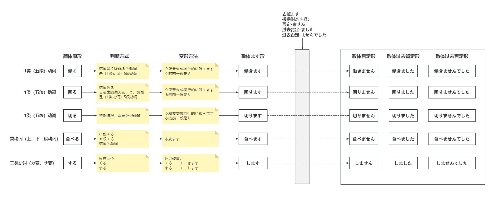

首先，从动词的基本形（简体）开始，如`書く（写）`。动词有“活用”这个概念，指动词本身进行变化（或不变化），然后接不同语法成分。

|  活用  |  词语变化  | 例如                                                         |
| :----: | :--------: | :----------------------------------------------------------- |
| 未然形 | 書か／書こ | 用于连接某些后续成分，例如「書かない」（不写）、「書こう」（打算写、写吧）。 |
| 连用形 |    書き    | 常用于连接后续成分，例如「書きます」（写）、「書きたい」（想写）。 |
| 终止形 |    書く    | 用来结束句子、陈述一件事。例如「本を書く。」（写书。）       |
| 连体形 |    書く    | 用来修饰名词。例如「本を書く人」（写书的人）。               |
| 假定形 |    書け    | 常用于表示条件，后接「ば」，形成「書けば」（如果写）。       |
| 命令形 |    書け    | 表示命令，例如「早く書け！」（快写！）。                     |

终止形和连体形有时长得完全一样，假定形和命令形也可能长得一样。这时需要根据上下文来判断。

书上所说的 `て形`、`た形`、`たい形` 等等，这些是通过动词活用形成的具体变化。

比如 `書きたい` 可以说是書く的 `たい形` 也可以说是書く的连用形加たい。这两者不冲突。

而　`ます`　形并不是独立于动词基本型存在，而是由动词基本形，通过活用的　`连用形`　变为　`書き`　后，续接　`ます`　变成　`書きます`这种礼貌表达形式。

动词基本形的时态变化ます形也全都有，所以常把 `ます形` 与 `基本形` 对立来看。但实际ます形是基本型的一种活用变化。

|      时态      | 基本形       | ます形           |
| :------------: | :----------- | :--------------- |
| 现在/将来 肯定 | 書く         | 書きます         |
| 现在/将来 否定 | 書かない     | 書きません       |
|   过去 肯定    | 書いた       | 書きました       |
|   过去 否定    | 書かなかった | 書きませんでした |

另外，ます形也可以继续“活用”，指ます进行活用变化

| 「ます」的活用形 | 形式         | 例子                     |
| ---------------- | ------------ | ------------------------ |
| 未然形           | ませ／ましょ | 書きません、書きましょう |
| 连用形           | まし         | 書きました、書きまして   |
| 终止形           | ます         | 書きます                 |
| 连体形           | ます         | 書きますとき（较少见）   |
| 假定形           | ますれ       | ますれば（较少见）       |

# 动词

## 活用形与各形态的对应关系

先记住这张“根表”，后面所有形态都是它的派生：

| 活用形 | 派生出来的形态        | 例                             |
| :----- | :-------------------- | :----------------------------- |
| 未然形 | ない形、意志形、被动、使役 | 書か**ない**、書こ**う**、書か**れる** |
| 连用形 | ます形、たい形、て形（部分） | 書きます、書きたい、書いて     |
| 终止形 | 简体结句              | 本を書く。                     |
| 连体形 | 修饰名词              | 書く人                         |
| 假定形 | ば形                  | 書けば                         |
| 命令形 | 命令形                | 書け！                         |

## 一、先判类型（三类）

判定顺序从三类往一类走，**不要反过来**：

1. `来る`、`する`（以及「名词+する」）→ **三类**，只有这两个（组）。
2. い段／え段 + `る`，且不在特例表里 → **二类**（一段动词）。
3. 其余全部 → **一类**（五段动词）。

### 一类（五段）

- 词尾不是 `る`：書く、話す、待つ、死ぬ、遊ぶ、読む、買う —— 一定是
- 词尾是 `る`，且 `る` 前面是 **あ段／う段／お段**：困る、怒る、やる、取る、戻る、座る

### 二类（一段）

- **い段 + る**：起きる、見る、借りる、降りる、浴びる
- **え段 + る**：食べる、教える、開ける、調べる、出る、寝る

### 特例：长得像二类，其实是一类

| 动词 | 读音 | 意思 |
| :--- | :--- | :--- |
| 帰る | かえる | 回家 |
| 入る | はいる | 进入 |
| 走る | はしる | 跑 |
| 切る | きる | 切 |
| 知る | しる | 知道 |
| 要る | いる | 需要 |
| 減る | へる | 减少 |
| 滑る | すべる | 滑 |
| 蹴る | ける | 踢 |
| 限る | かぎる | 限于 |
| 参る | まいる | 去（谦让） |
| 焦る | あせる | 着急 |

这类没有统一规律，只能记：**先按「い段／え段+る = 二类」套，遇到上表里的词再单独改判。**考试和应用课文里出现频率最高的就是帰る、入る、走る、切る、知る这五个。

否定 `ません`、过去 `ました`、过去否定 `ませんでした` 都是在「ます」上换尾巴，动词部分不动。

### たい形（愿望）

规则只有一条：**ます形去掉「ます」+ たい**，三类也一样。所以它的变化完全跟一类形容词走。

| 原形 | たい形 | 否定 | 过去 | 过去否定 |
| :--- | :--- | :--- | :--- | :--- |
| 食べる | 食べたい | 食べたくない | 食べたかった | 食べたくなかった |
| 書く | 書きたい | 書きたくない | 書きたかった | 書きたくなかった |
| する | したい | したくない | したかった | しなかった |
| 来る | 来たい | 来たくない | 来たかった | 来たくなかった |

敬体否定 `～たくありません`、敬体过去否定 `～たくありませんでした`。对象助词可以用 `を` 也可以用 `が`（`水を飲みたい／水が飲みたい`）。

### て形／た形

**た形 = て形把 `て` 换 `た`、`で` 换 `だ`**，所以只要会て形就会た形。

一类动词走「音便」，按词尾分五组：

| 词尾 | て形 | た形 | 例 |
| :--- | :--- | :--- | :--- |
| う／つ／る | って | った | 洗う→洗って、待つ→待って、やる→やって |
| む／ぶ／ぬ | んで | んだ | 読む→読んで、遊ぶ→遊んで、死ぬ→死んで |
| く | いて | いた | 書く→書いて、歩く→歩いて |
| ぐ | いで | いだ | 急ぐ→急いで、泳ぐ→泳いで |
| す | して | した | 話す→話して、貸す→貸して |

| 类型 | 规则 | 例 |
| :--- | :--- | :--- |
| 二类 | 去 `る` + て／た | 食べる→食べて、調べる→調べて |
| 三类 | して／来て | する→して、来る→きて |

特例：`行く → 行って／行った`（不是「行いて」）。`ある → あって／あった` 走的是う段规则，正常。

用途：て形接 `ください／いる／みる／おく／から`；た形接 `ことがある／ほうがいい／ら／り`。

### ない形

| 类型 | 规则 | 例 |
| :--- | :--- | :--- |
| 一类 | 词尾う段 → **あ段** + ない（`う` → `わ`） | 書く→書かない、買う→買わない、待つ→待たない |
| 二类 | 去 `る` + ない | 食べる→食べない |
| 三类 | しない／こない | する→しない、来る→こない |

特例：`ある → ない`（不是「あらない」）。过去否定 `ない → なかった`：書かなかった、食べなかった。

### 意志形（う／よう）

| 类型 | 规则 | 例 |
| :--- | :--- | :--- |
| 一类 | 词尾う段 → **お段** + う | 書く→書こう、買う→買おう、待つ→待とう |
| 二类 | 去 `る` + よう | 食べる→食べよう、見る→見よう |
| 三类 | しよう／こよう | する→しよう、来る→こよう |

接 `と思います` 表打算：`食べようと思います`（我打算吃）。敬体用 `ましょう`。

### 可能形

| 类型 | 规则 | 例 |
| :--- | :--- | :--- |
| 一类 | 词尾う段 → **え段** + る | 書く→書ける、買う→買える、待つ→待てる |
| 二类 | 去 `る` + られる | 食べる→食べられる（口语 ら抜き：食べれる） |
| 三类 | できる／こられる | する→できる、来る→こられる（口语 来れる） |

可能形本身是二类动词，所以「書けます」「食べられます」这样变。

### ば形（假定形）

| 类型 | 规则 | 例 |
| :--- | :--- | :--- |
| 一类 | 词尾う段 → **え段** + ば（= 命令形 + ば） | 書く→書けば、買う→買えば |
| 二类 | 去 `る` + れば | 食べる→食べれば |
| 三类 | すれば／くれば | する→すれば、来る→くれば |

### 命令形／禁止形

| 类型 | 命令形 | 例 |
| :--- | :--- | :--- |
| 一类 | 词尾う段 → **え段** | 書く→書け、待つ→待て |
| 二类 | 去 `る` + ろ | 食べる→食べろ |
| 三类 | しろ／こい | する→しろ（せよ）、来る→こい |

禁止形最简单：**基本形 + な**。書くな、食べるな、するな、来るな。

缓和一点用 `ます形（去ます）+ なさい`：書きなさい、食べなさい、しなさい、来なさい。

### 被动形（れる／られる）

| 类型 | 规则 | 例 |
| :--- | :--- | :--- |
| 一类 | 词尾う段 → **あ段** + れる | 書く→書かれる、買う→買われる |
| 二类 | 去 `る` + られる | 食べる→食べられる |
| 三类 | される／こられる | する→される、来る→こられる |

注意：**二类动词的被动形和可能形完全同形**（食べられる），只能看上下文和助词分辨（被动常用 `に`，可能常用 `が`）。

### 使役形（せる／させる）

| 类型 | 规则 | 例 |
| :--- | :--- | :--- |
| 一类 | 词尾う段 → **あ段** + せる | 書く→書かせる、行く→行かせる |
| 二类 | 去 `る` + させる | 食べる→食べさせる |
| 三类 | させる／こさせる | する→させる、来る→こさせる |

使役被动 = 使役形 + られる（させられる），一类口语音便有缩约：書か**される**（=書かせられる）、行かされる。

### 敬语形

| 形式 | 规则 | 例 |
| :--- | :--- | :--- |
| 尊敬 | `お` + ます形去ます + `になる` | 書く→お書きになる、帰る→お帰りになる、読む→お読みになる |
| 尊敬（更简单） | 被动形 | 書かれる、来られる、食べられる |
| 谦让 | `お` + ます形去ます + `する` | お持ちします、ご案内します |

`する` 动词用 `ご + 名词 + する／いたす`：ご案内します、ご連絡いたします。

# 形容词

## 分类

| 类型 | 判定 | 例 |
| :--- | :--- | :--- |
| 一类（い形容词） | 词尾是 `い`，且汉字上带い | 熱い、寒い、高い、忙しい |
| 二类（な形容词） | 不以 `い` 结尾 | 静か、便利、好き、元気 |

特例：`綺麗（きれい）`、`詳細（しょうさい）`、`愉快（ゆかい）`、`嫌い（きらい）` 读音末尾是い，但书写上没有い，属于**二类**。

## 变形

| 类型 | 例词 | 肯定 | 否定 | 过去肯定 | 过去否定 |
| :--: | :--: | :--: | :--: | :--: | :--: |
| 一类 | 熱い | 熱い`です` | 熱`くないです`／熱`くありません` | 熱`かったです` | 熱`くなかったです`／熱`くありませんでした` |
| 二类 | 好き | 好き`です` | 好き`[では／じゃ]ありません` | 好き`でした` | 好き`[では／じゃ]ありませんでした` |
| 名词 | 学生 | 学生`です` | 学生` [では / じゃ] ありません` | 学生`でした` | 学生`[では／じゃ]ありませんでした` |

### 其他派生

| 形式 | 一类（高い） | 二类（静か） |
| :--- | :--- | :--- |
| 修饰名词 | 高い本 | 静か**な**部屋 |
| 副词（连用） | 高**く**なる | 静か**に**なる |
| て形（并列） | 高**くて** | 静か**で** |
| ば形（假定） | 高**ければ** | 静か**なら（ば）** |
| 名词化 | 高**さ** | 静か**さ** |

简体形（普通体）：一类直接去 `です`（高い／高くない／高かった）；二类、名词用 `だ`（静かだ／静かじゃない／静かだった）。
